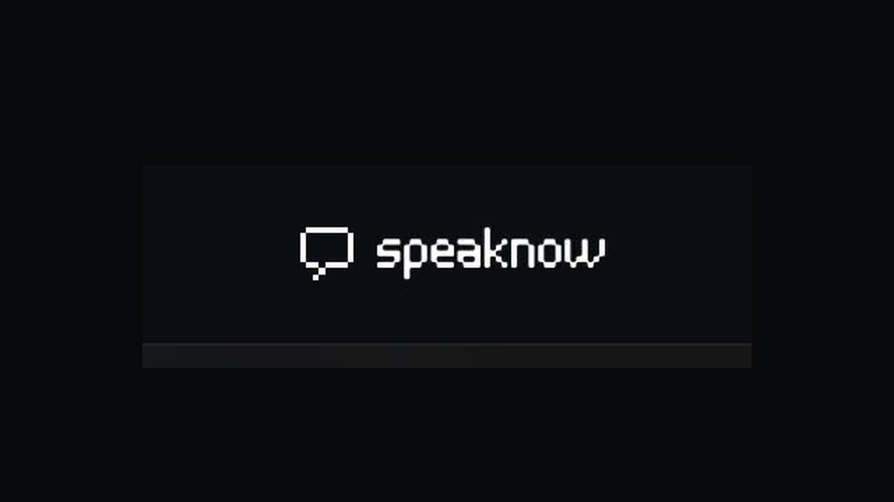
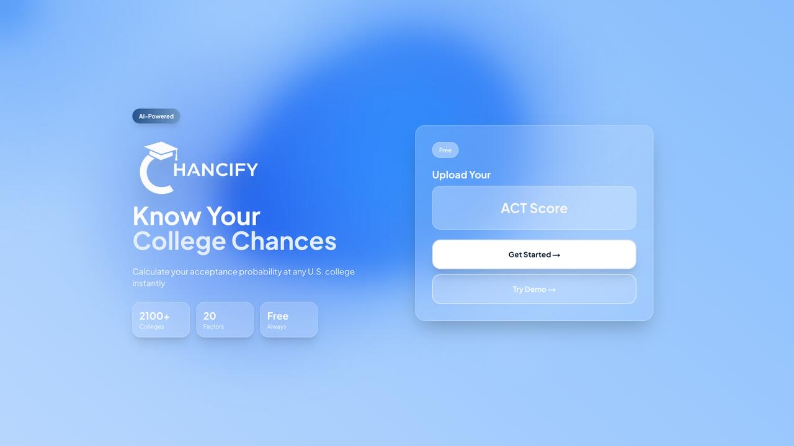
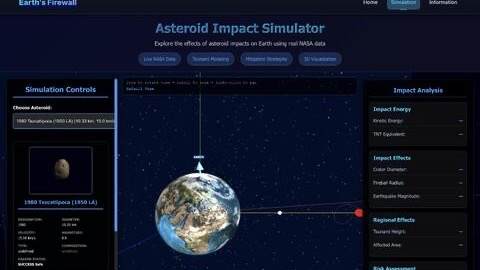

<picture>
  <source media="(max-width: 600px)" srcset="https://capsule-render.vercel.app/api?type=waving&color=0:7C3AED%2C50:2563EB%2C100:06B6D4&height=250&section=header&text=Abhi%20Jandyala&fontSize=84&fontColor=ffffff&fontAlignY=36&animation=fadeIn&desc=Founder%20and%20CEO%20%40%20ValiqAI&descAlignY=62&descSize=36"/>
  
</picture>

<a href="https://abhijandyala.com">
<picture>
  <source media="(max-width: 600px)" srcset="https://readme-typing-svg.demolab.com?font=Inter&weight=500&size=17&pause=1400&color=A78BFA&center=true&vCenter=true&width=340&lines=Building+QA+agents+%40+ValiqAI+%F0%9F%A4%96;Top+10+at+YC+VibeCon+SF+2026;AI+Agents+%C2%B7+CV+%C2%B7+Full-Stack+SaaS;11th+grader+shipping+real+AI+%F0%9F%9A%80"/>
  
</picture>
</a>

---

## ✦ About Me

I'm a **17-year-old founder and builder** in 11th grade at Marvin Ridge High School, focused on making AI work **outside of demos**.

Right now I'm building **[ValiqAI](https://valiqai.com)** as a solo technical founder: browser agents that navigate real web apps, find the sign-up and login flows on their own, run tests, and return bugs with **replayable evidence**.

I like taking hard ideas from a blank screen to a real product, across web development, browser automation, and applied machine learning. I've placed **Top 10 at YC VibeCon SF**, won hackathons in San Francisco, and shipped products real people use.

> **Currently:** building ValiqAI into a product real engineering teams can trust.

<picture>
  <source media="(max-width: 600px)" srcset="https://raw.githubusercontent.com/abhijandyala/abhijandyala/main/assets/skills-mobile.svg"/>
  
</picture>
  
<picture>
  <source media="(max-width: 600px)" srcset="https://raw.githubusercontent.com/abhijandyala/abhijandyala/main/assets/highlights-mobile.svg"/>
  
</picture>

---

## ✦ My Personal Website

**🌐 [abhijandyala.com](https://abhijandyala.com)**: every project, award and story behind them, in one interactive map.

---

## ✦ Experience & Education

🚀 **Founder & CEO · [ValiqAI](https://valiqai.com)** 
Jan 2026 – Present 
Building an autonomous QA platform as a solo technical founder: browser agents that navigate apps, discover sign-up and login flows, run tests and capture failures with replayable evidence.

🧠 **AI Innovator Intern · Bright Tier Solutions** 
Dec 2025 – Present 
Built the backend parsing system for RMS, which builds websites for businesses in minutes. Now working on AI projects that apply machine learning to real business use cases.

🎓 **Marvin Ridge High School** 
Grade 11 · Class of 2028 
Computer Science, AI and Software Development · Harvard AI Bootcamp 
TSA · DECA · FBLA · HOSA · Robotics · Speech & Debate · Cross Country · Track & Field

---

## ✦ Featured Projects

<table>
<tr>
<td>

### 🧪 [ValiqAI](https://valiqai.com) &nbsp;·&nbsp; *what I'm building full-time*
**Autonomous AI QA for web apps**

▶ A real ValiqAI scan: paste a URL, watch agents test every flow live, then get each bug with a replay and how to fix it (2× speed)

Real browsers that use your app like a user would: create accounts, verify emails, log in, walk through workflows, catch visual bugs and probe for security issues, without anyone scripting every path. Every failure comes back with replayable evidence.

`Browser Agents` `Playwright` `TypeScript` `Python` `LLMs` `Founder & CEO`

</td>
</tr>
<tr>
<td>

### 🎤 [SpeakNow](https://www.usespeaknow.com/)

**AI public speaking coach** · Aug 2026 – Now

Practice a speech in front of a **panel of 6 AI judges** and get a scored report on delivery, pacing and clarity. End-to-end recording, analysis, scoring and progress tracking.

`LLMs` `Speech Analysis` `Full-Stack`

</td>
</tr>
<tr>
<td>

### 🛰️ [Aegis](https://aegisisr.up.railway.app/)

**Maritime dark-vessel intelligence** · Jul 2026 – Now

Tracks ships from live AIS data and flags identity changes, geofence violations and dark-vessel activity. Kalman filtering plus **600-run Monte Carlo simulations** predict where vessels are heading across 10 high-traffic regions.

`Python` `Kalman Filter` `Monte Carlo` `Geospatial`

</td>
</tr>
<tr>
<td>

### 📞 [Booked](https://docs-build.emergent.host/)

**AI salesperson for small businesses** · 🏆 *Top 10, YC VibeCon SF*

Answers calls, qualifies leads, books appointments and learns about customers over time. We landed our **first paying customer ($30/month) within 48 hours** of the hackathon.

`AI Agents` `Voice` `Emergent` `MongoDB`

</td>
</tr>
<tr>
<td>

### 🏠 [SafeSight](https://safesight.up.railway.app/) · [repo](https://github.com/alleti01/SafeSight)

**Home safety for people living with dementia** · 🥈 *2nd, BananaHacks*

Film a room, and it finds what could confuse or trip someone. Fine-tuned **YOLO-World on an H100** over ~55K images, raising objects found per room on unseen homes from **42% to 78%**. People in videos are blurred and uploads are deleted after analysis.

`YOLO-World` `PyTorch` `Computer Vision` `Privacy`

</td>
</tr>
<tr>
<td>

### 🧩 [Domino](https://dominoai.up.railway.app/) · [repo](https://github.com/alleti01/Domino) · [deck](https://drive.google.com/drive/folders/1Z_MY50JCxxcAthWYgwo0o7ThD5bHBjmn?usp=sharing)

**Finds what a code change will break, before it ships** · 🎖️ *Honorable Mention, Open Agent Hackathon*

Inspired by the Cloudflare and CrowdStrike outages: an AI agent that tests a change against everything it touches, running the original, changed and reverted versions in throwaway sandboxes to prove the cause.

`NVIDIA Nemotron` `Zetaris` `Meterless` `TypeScript`

</td>
</tr>
<tr>
<td>

### 👻 [GhostThread](https://github.com/abhijandyala/ghostthread)

**Feedback in, shipped fixes out** · 🥇 *3× 1st, Agents Love You 2*

An AI agent that joins Slack, Gmail, Linear and GitHub, finds customer complaints that never became tracked work, files the ticket, makes the code change and opens the PR.

`AI Agents` `HydraDB` `Python` `GitHub API`

</td>
</tr>
<tr>
<td>

### 🎓 [ChancifyAI](https://www.chancifyai.com/)

**College admissions predictor** · 🏛️ *4th, Congressional App Challenge*

Personalized acceptance odds built on real admissions data, plus college search, profile analysis and an AI college assistant. Used by **350+ students**.

`Machine Learning` `Next.js` `AI Assistant`

</td>
</tr>
<tr>
<td>

### ☄️ [Meteor Madness](https://nasahackathon.up.railway.app/)

**NASA Space Apps asteroid simulator**

Uses real NASA asteroid data (size, speed, trajectory) to simulate impacts on Earth in an interactive **3D** visualization.

`Three.js` `3D Visualization` `NASA Data`

</td>
</tr>
</table>

More on my GitHub: <a href="https://github.com/abhijandyala/Wallio">Wallio</a> · <a href="https://github.com/abhijandyala/runbook">Runbook</a> · <a href="https://github.com/abhijandyala/Proofline">Proofline</a> · <a href="https://github.com/abhijandyala/siddy">VOCA (Roblox)</a>

---

## ✦ Honors & Awards

| | Award | When |
|:-:|---|---|
| 🎖️ | **Honorable Mention** · Open Agent Hackathon 2026 [Domino](https://dominoai.up.railway.app/) · builders from 138 countries · sponsored by NVIDIA, Zetaris, SpaceX AI and Meterless | Nov 2026 |
| 🥈 | **2nd Place Overall** · BananaHacks 2026 [SafeSight](https://safesight.up.railway.app/) · 800+ builders from 50+ countries | Oct 2026 |
| 🏆 | **Top 10 Finalist** · Emergent × YC VibeCon SF 2026 [Booked](https://docs-build.emergent.host/) · ~5,000 applicants, presented at Y Combinator | Oct 2026 |
| 🥇 | **1st Place · Best Use of RocketRide** · Memory Meets Motion Hackathon, SF [Runbook](https://github.com/abhijandyala/runbook) | Aug 2026 |
| 🥇 | **1st Place AI Agents + 2× 1st DevTools** · Agents Love You 2, SF [GhostThread](https://github.com/abhijandyala/ghostthread) | Jul 2026 |
| 🌍 | **15th Place Globally** · USAII Global AI Hackathon 6,000+ registrations from 160+ countries | Jun 2026 |
| 🎮 | **4th at Nationals** · FBLA Computer Game & Simulation [VOCA](https://github.com/abhijandyala/siddy) | Jun 2026 |
| 🎬 | **State Champion** · TSA Digital Video Production *Twisted In Time With Mr. Tesla* | Apr 2026 |
| 🏛️ | **4th Place, CD14** · Congressional App Challenge [ChancifyAI](https://www.chancifyai.com/) · U.S. House of Representatives | Oct 2025 |
| 🥇 | **1st Place · Data Analysis** · RidgeHacks (BRHS Hackathon) | Jul 2025 |
| 🎓 | **High Honors** · Johns Hopkins CTY | Jan 2024 |

 Presenting Booked as a Top 10 finalist at Emergent × YC VibeCon SF 2026, at Y Combinator

---

## ✦ Tech Stack

**Languages**

**AI / ML**

**Web & Automation**

**Infra**

---

## ✦ GitHub Activity

<picture>
  <source media="(max-width: 600px)" srcset="https://streak-stats.demolab.com?user=abhijandyala&hide_border=true&background=0D1117&ring=8B5CF6&fire=22D3EE&currStreakNum=FFFFFF&sideNums=FFFFFF&currStreakLabel=A78BFA&sideLabels=A78BFA&dates=8B949E&stroke=30363D&card_width=340&card_height=200"/>
  
</picture>

  

<picture>
  <source media="(prefers-color-scheme: dark)" srcset="https://raw.githubusercontent.com/abhijandyala/abhijandyala/output/github-snake-dark.svg"/>
  
</picture>

---

## ✦ Connect

**Always open to meeting founders, engineers, and anyone building ambitious things with AI.**

