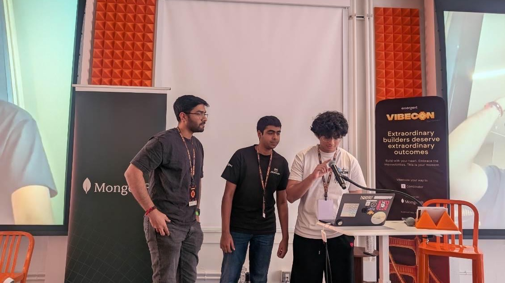
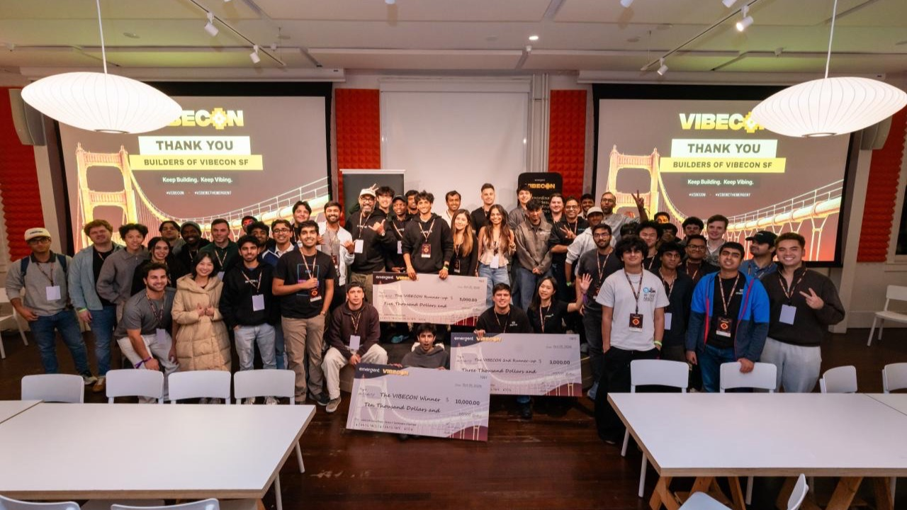

<div align="center">


</div>

<div align="center">

[;AI+Agents+%C2%B7+Computer+Vision+%C2%B7+Full-Stack+SaaS;11th+grader+taking+AI+past+the+demo+%F0%9F%9A%80)](https://abhijandyala.com)

<a href="https://abhijandyala.com"></a>
<a href="https://valiqai.com"></a>
<a href="https://www.linkedin.com/in/abhi-jandyala-7875a12a8/"></a>


</div>

---

## ✦ About Me

I'm a **17-year-old founder and builder** in 11th grade at Marvin Ridge High School, focused on making AI work **outside of demos**.

Right now I'm building **[ValiqAI](https://valiqai.com)** as a solo technical founder: browser agents that navigate real web apps, find the sign-up and login flows on their own, run tests, and return bugs with **replayable evidence**.

I like taking hard ideas from a blank screen to a real product, across web development, browser automation, and applied machine learning. I've placed **Top 10 at YC VibeCon SF**, won hackathons in San Francisco, and shipped products real people use.

```text
🤖  AI Agents & Browser Automation   ████████████████████   shipping @ ValiqAI
🌐  Full-Stack SaaS                  ████████████████████   Next.js · React · FastAPI
👁️  Computer Vision & ML             ████████████████░░░░   YOLO-World on H100s
🛰️  Simulation & Geospatial          ██████████████░░░░░░   Kalman + Monte Carlo
```

<div align="center">

</div>

---

## ✦ Experience

| | Role | When |
|---|---|---|
| 🚀 | **Founder & CEO, [ValiqAI](https://valiqai.com)**: autonomous QA platform with browser agents and replayable bug evidence | Jan 2026 – Present |
| 🤝 | **Co-Founder & CEO, VentraMatch**: AI that matches startups with investors by industry, stage, check size and thesis | Apr 2026 – Present |
| 🧠 | **AI Innovator Intern, Bright Tier Solutions**: built the backend parsing system for RMS, which builds business websites in minutes | Dec 2025 – Present |

---

## ✦ Featured Projects

<table>
<tr>
<td colspan="2" valign="top">

### 🧪 [ValiqAI](https://valiqai.com) &nbsp;·&nbsp; *what I'm building full-time*
**Autonomous AI QA for web apps**

Real browsers that use your app like a user would: create accounts, verify emails, log in, walk through workflows, catch visual bugs and probe for security issues, without anyone scripting every path. Every failure comes back with replayable evidence.

`Browser Agents` `Playwright` `TypeScript` `Python` `LLMs` `Founder & CEO`

</td>
</tr>
<tr>
<td width="50%" valign="top">

<a href="https://www.usespeaknow.com/"></a>

### 🎤 [SpeakNow](https://www.usespeaknow.com/)
**AI public speaking coach**

Practice a speech in front of a **panel of 6 AI judges** and get a scored report on delivery, pacing and clarity. End-to-end recording, analysis, scoring and progress tracking.

`LLMs` `Speech Analysis` `Full-Stack` `Aug 2026 – Now`

</td>
<td width="50%" valign="top">

<a href="https://aegisisr.up.railway.app/"></a>

### 🛰️ [Aegis](https://aegisisr.up.railway.app/)
**Maritime dark-vessel intelligence**

Tracks ships from live AIS data and flags identity changes, geofence violations and dark-vessel activity. Kalman filtering plus **600-run Monte Carlo simulations** predict where vessels are heading.

`Python` `Kalman Filter` `Monte Carlo` `Geospatial`

</td>
</tr>
<tr>
<td width="50%" valign="top">

<a href="https://docs-build.emergent.host/"></a>

### 📞 [Booked](https://docs-build.emergent.host/)
**AI salesperson for small businesses** · 🏆 *Top 10, YC VibeCon SF*

Answers calls, qualifies leads and books appointments, and learns about customers over time. We landed our **first paying customer within 48 hours** of the hackathon.

`AI Agents` `Voice` `Emergent` `MongoDB`

</td>
<td width="50%" valign="top">

<a href="https://safesight.up.railway.app/"></a>

### 🏠 [SafeSight](https://safesight.up.railway.app/) · [repo](https://github.com/alleti01/SafeSight)
**Home safety for people living with dementia** · 🥈 *2nd, BananaHacks*

Film a room, and it finds what could confuse or trip someone. Fine-tuned **YOLO-World on an H100** over ~55K images, raising objects found per room on unseen homes from **42% to 78%**.

`YOLO-World` `PyTorch` `Computer Vision` `Privacy`

</td>
</tr>
<tr>
<td width="50%" valign="top">

<a href="https://github.com/abhijandyala/ghostthread"></a>

### 👻 [GhostThread](https://github.com/abhijandyala/ghostthread)
**Feedback in, shipped fixes out** · 🥇 *3× 1st, Agents Love You 2*

An AI agent that joins Slack, Gmail, Linear and GitHub, finds customer complaints that never became tracked work, files the ticket, drafts the fix and replies to whoever reported it.

`AI Agents` `HydraDB` `Python` `GitHub API`

</td>
<td width="50%" valign="top">

<a href="https://www.chancifyai.com/"></a>

### 🎓 [ChancifyAI](https://www.chancifyai.com/)
**College admissions predictor** · 🏛️ *4th, Congressional App Challenge*

Personalized acceptance odds built on real admissions data, plus college search, profile analysis and an AI college assistant. Used by **350+ students**.

`Machine Learning` `Next.js` `AI Assistant`

</td>
</tr>
<tr>
<td width="50%" valign="top">

<a href="https://dominoai.up.railway.app/"></a>

### 🧩 [Domino](https://dominoai.up.railway.app/) · [repo](https://github.com/alleti01/Domino)
**Pre-deployment failure investigation**

An AI agent that works out how one change could break connected systems before it ships, then tests the original, changed and reverted versions in isolated sandboxes to prove the cause.

`NVIDIA Nemotron` `Zetaris` `TypeScript` `React`

</td>
<td width="50%" valign="top">

<a href="https://nasahackathon.up.railway.app/"></a>

### ☄️ [Meteor Madness](https://nasahackathon.up.railway.app/)
**NASA Space Apps asteroid simulator**

Uses real NASA asteroid data (size, speed, trajectory) to simulate impacts on Earth in an interactive **3D** visualization.

`Three.js` `3D Visualization` `NASA Data`

</td>
</tr>
</table>

<div align="center">
<sub>More on my GitHub: <a href="https://github.com/abhijandyala/Wallio">Wallio</a> · <a href="https://github.com/abhijandyala/runbook">Runbook</a> · <a href="https://github.com/abhijandyala/Proofline">Proofline</a> · <a href="https://github.com/abhijandyala/siddy">VOCA (Roblox)</a></sub>
</div>

---

## ✦ Honors & Awards

| | Award | Event | Project | Date |
|---|---|---|---|---|
| 🥈 | **2nd Place Overall** | BananaHacks 2026 · 800+ builders, 50+ countries | [SafeSight](https://safesight.up.railway.app/) | Oct 2026 |
| 🏆 | **Top 10 Finalist** | Emergent × YC VibeCon SF 2026 · ~5,000 applicants | [Booked](https://docs-build.emergent.host/) | Oct 2026 |
| 🥇 | **1st Place · Best Use of RocketRide** | Memory Meets Motion Hackathon, SF | [Runbook](https://github.com/abhijandyala/runbook) | Aug 2026 |
| 🥇 | **1st Place · AI Agents + 2× 1st · DevTools** | Agents Love You 2 Hackathon, SF | [GhostThread](https://github.com/abhijandyala/ghostthread) | Jul 2026 |
| 🌍 | **15th Place Globally** | USAII Global AI Hackathon · 6,000+ registrations, 160+ countries | | Jun 2026 |
| 🎮 | **4th at Nationals** | FBLA · Computer Game & Simulation | [VOCA](https://github.com/abhijandyala/siddy) | Jun 2026 |
| 🎬 | **State Champion** | TSA · Digital Video Production | *Twisted In Time With Mr. Tesla* | Apr 2026 |
| 🏛️ | **4th Place, CD14** | Congressional App Challenge (U.S. House) | [ChancifyAI](https://www.chancifyai.com/) | Oct 2025 |
| 🥇 | **1st Place · Data Analysis** | RidgeHacks (BRHS Hackathon) | | Jul 2025 |
| 🎓 | **High Honors** | Johns Hopkins CTY | | Jan 2024 |

<div align="center">


<br/><sub>Presenting Booked as a Top 10 finalist at Emergent × YC VibeCon SF 2026, at Y Combinator</sub>
</div>

---

## ✦ Tech Stack

**Languages**


**AI / ML**


**Web & Automation**


**Infra**


---

## ✦ GitHub Activity

<div align="center">


<br/><br/>

<picture>
  <source media="(prefers-color-scheme: dark)" srcset="https://raw.githubusercontent.com/abhijandyala/abhijandyala/output/github-snake-dark.svg"/>
  
</picture>

</div>

---

## ✦ Connect

<div align="center">

[](https://www.linkedin.com/in/abhi-jandyala-7875a12a8/)
[](https://abhijandyala.com)
[](https://valiqai.com)
[](mailto:abhi@valiqai.com)
[](https://www.instagram.com/abhij_journey/)

**Always open to meeting founders, engineers, and anyone building ambitious things with AI.**

</div>

<div align="center">

</div>
