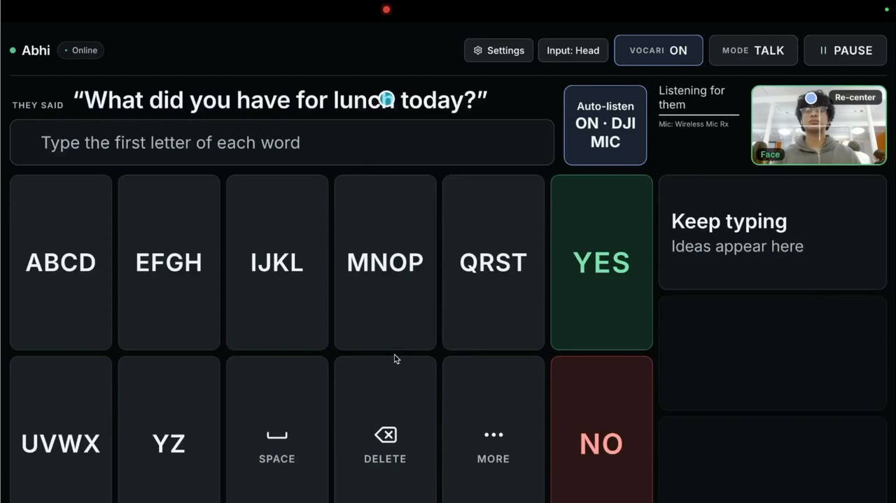
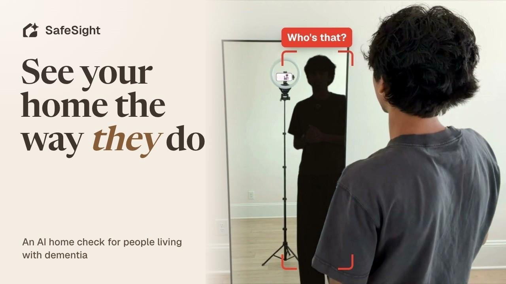
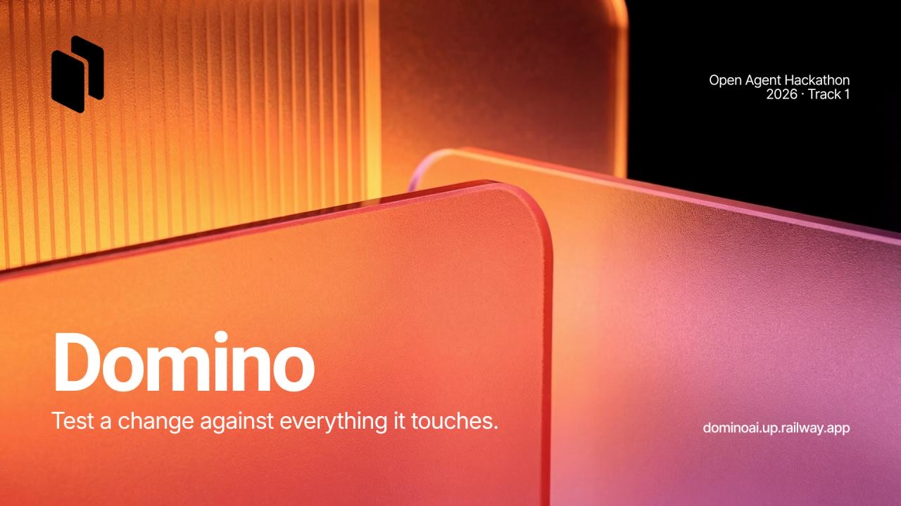
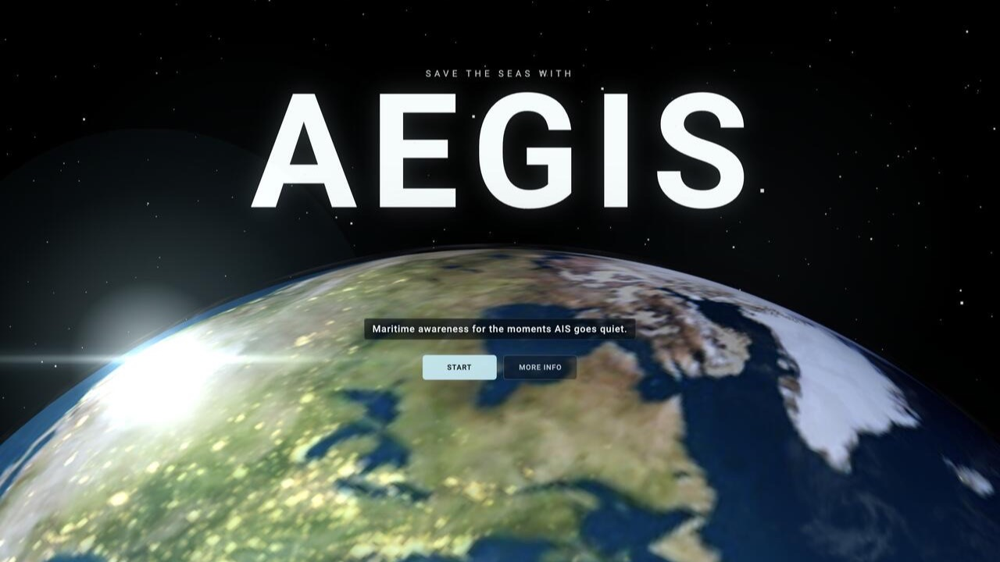
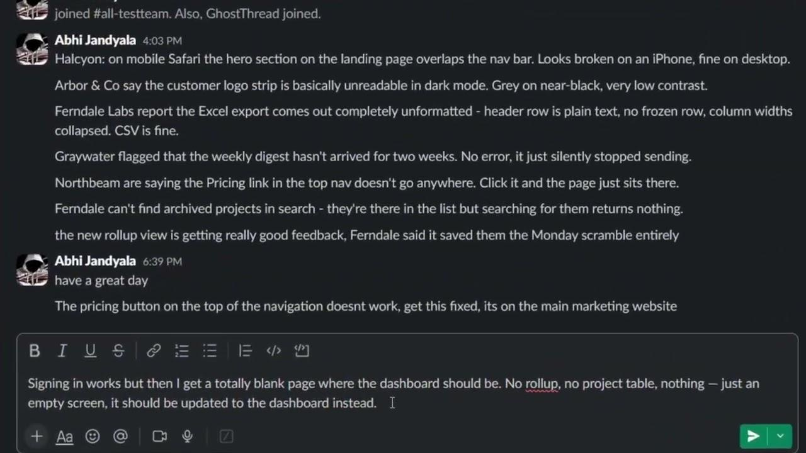
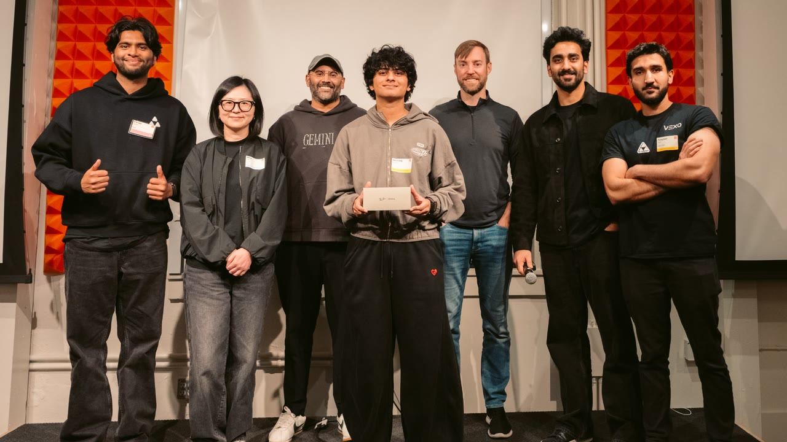

<picture>
  <source media="(max-width: 600px)" srcset="https://raw.githubusercontent.com/abhijandyala/abhijandyala/main/assets/header-mobile.svg"/>
  
</picture>

<a href="https://abhijandyala.com">abhijandyala.com</a> &nbsp;·&nbsp; <a href="https://valiqai.com">valiqai.com</a> &nbsp;·&nbsp; <a href="https://www.linkedin.com/in/abhi-jandyala-7875a12a8/">LinkedIn</a> &nbsp;·&nbsp; <a href="mailto:abhi@valiqai.com">abhi@valiqai.com</a>

## About

I'm a **17-year-old founder and builder** in 11th grade at Marvin Ridge High School, focused on making AI work **outside of demos**.

Right now I'm building **[ValiqAI](https://valiqai.com)** as a solo technical founder: browser agents that navigate real web apps, find the sign-up and login flows on their own, run tests, and return bugs with **replayable evidence**.

I like taking hard ideas from a blank screen to a real product, across web development, browser automation, and applied machine learning. I've placed **Top 10 at YC VibeCon SF**, won hackathons in San Francisco, and shipped products real people use.

> **Currently:** building ValiqAI into a product real engineering teams can trust.

<picture>
  <source media="(max-width: 600px)" srcset="https://raw.githubusercontent.com/abhijandyala/abhijandyala/main/assets/skills-mobile.svg"/>
  
</picture>
  
<picture>
  <source media="(max-width: 600px)" srcset="https://raw.githubusercontent.com/abhijandyala/abhijandyala/main/assets/highlights-mobile.svg"/>
  
</picture>

## Personal Website

<a href="https://abhijandyala.com">abhijandyala.com</a> &nbsp;·&nbsp; every project, award and the story behind them, in one interactive map

## Experience & Education

**Founder & CEO · [ValiqAI](https://valiqai.com)** 
Jan 2026 – Present 
Building an autonomous QA platform as a solo technical founder: browser agents that navigate apps, discover sign-up and login flows, run tests and capture failures with replayable evidence.

**AI Innovator Intern · Bright Tier Solutions** 
Dec 2025 – Present 
Built the backend parsing system for RMS, which builds websites for businesses in minutes. Now working on AI projects that apply machine learning to real business use cases.

**Marvin Ridge High School** 
Grade 11 · Class of 2028 
Computer Science, AI and Software Development · Harvard AI Bootcamp 
TSA · DECA · FBLA · HOSA · Robotics · Speech & Debate · Cross Country · Track & Field

## Featured Projects

<table>
<tr>
<td>

### [ValiqAI](https://valiqai.com)
**Autonomous AI QA for web apps** · *what I'm building full-time*

A real ValiqAI scan: paste a URL, watch agents test every flow live, then get each bug with a replay and how to fix it (2× speed)

Real browsers that use your app like a user would: create accounts, verify emails, log in, walk through workflows, catch visual bugs and probe for security issues, without anyone scripting every path. Every failure comes back with replayable evidence.

`Browser Agents` `Playwright` `TypeScript` `Python` `LLMs`

</td>
</tr>
<tr>
<td>

### [Vocari](https://devpost.com/software/vocari) · [demo](https://www.youtube.com/watch?v=HFialkpQRdE)

**Gives a voice back to people who can't speak** · *1st Stripe Track, 3rd Overall, VexoHacks*

Your eyes are the cursor. Type only the first letter of each word and Vocari speaks the whole sentence: a fine-tuned **NVIDIA Nemotron** model runs on the laptop and suggests 3 full sentences, even offline, using what your Vexo band heard earlier in the day. **DO mode** opens the web and buys anything with Stripe, and nothing is paid until you press PAY.

`NVIDIA Nemotron` `Eye Tracking` `On-Device AI` `Stripe` `Vexo`

</td>
</tr>
<tr>
<td>

### [Booked](https://docs-build.emergent.host/)

**AI salesperson for small businesses** · *Top 10, YC VibeCon SF*

Answers calls, qualifies leads, books appointments and learns about customers over time. We landed our **first paying customer ($30/month) within 48 hours** of the hackathon.

`AI Agents` `Voice` `Emergent` `MongoDB`

</td>
</tr>
<tr>
<td>

### [SafeSight](https://safesight.up.railway.app/) · [repo](https://github.com/alleti01/SafeSight)

**Home safety for people living with dementia** · *2nd Overall, BananaHacks*

Film a room, and it finds what could confuse or trip someone. Fine-tuned **YOLO-World on an H100** over ~55K images, raising objects found per room on unseen homes from **42% to 78%**. People in videos are blurred and uploads are deleted after analysis.

`YOLO-World` `PyTorch` `Computer Vision` `Privacy`

</td>
</tr>
<tr>
<td>

### [Domino](https://dominoai.up.railway.app/) · [repo](https://github.com/alleti01/Domino) · [deck](https://drive.google.com/drive/folders/1Z_MY50JCxxcAthWYgwo0o7ThD5bHBjmn?usp=sharing)

**Finds what a code change will break, before it ships** · *Honorable Mention, Open Agent Hackathon*

Inspired by the Cloudflare and CrowdStrike outages: an AI agent that tests a change against everything it touches, running the original, changed and reverted versions in throwaway sandboxes to prove the cause.

`NVIDIA Nemotron` `Zetaris` `Meterless` `TypeScript`

</td>
</tr>
<tr>
<td>

### [SpeakNow](https://www.usespeaknow.com/)

**AI public speaking coach** · Aug 2026 – Now

Practice a speech in front of a **panel of 6 AI judges** and get a scored report on delivery, pacing and clarity. End-to-end recording, analysis, scoring and progress tracking.

`LLMs` `Speech Analysis` `Full-Stack`

</td>
</tr>
<tr>
<td>

### [Aegis](https://aegisisr.up.railway.app/)

**Maritime dark-vessel intelligence** · Jul 2026 – Now

Tracks ships from live AIS data and flags identity changes, geofence violations and dark-vessel activity. Kalman filtering plus **600-run Monte Carlo simulations** predict where vessels are heading across 10 high-traffic regions.

`Python` `Kalman Filter` `Monte Carlo` `Geospatial`

</td>
</tr>
<tr>
<td>

### [GhostThread](https://github.com/abhijandyala/ghostthread)

**Feedback in, shipped fixes out** · *3× 1st Place, Agents Love You 2*

An AI agent that joins Slack, Gmail, Linear and GitHub, finds customer complaints that never became tracked work, files the ticket, makes the code change and opens the PR.

`AI Agents` `HydraDB` `Python` `GitHub API`

</td>
</tr>
<tr>
<td>

### [ChancifyAI](https://www.chancifyai.com/)

**College admissions predictor** · *4th, Congressional App Challenge*

Personalized acceptance odds built on real admissions data, plus college search, profile analysis and an AI college assistant. Used by **350+ students**.

`Machine Learning` `Next.js` `AI Assistant`

</td>
</tr>
<tr>
<td>

### [Meteor Madness](https://nasahackathon.up.railway.app/)

**NASA Space Apps asteroid simulator**

Uses real NASA asteroid data (size, speed, trajectory) to simulate impacts on Earth in an interactive **3D** visualization.

`Three.js` `3D Visualization` `NASA Data`

</td>
</tr>
</table>

More on my GitHub: <a href="https://github.com/abhijandyala/Wallio">Wallio</a> · <a href="https://github.com/abhijandyala/runbook">Runbook</a> · <a href="https://github.com/abhijandyala/Proofline">Proofline</a> · <a href="https://github.com/abhijandyala/siddy">VOCA (Roblox)</a>

## Honors & Awards

| Award | Date |
|---|---|
| **1st Place, Stripe Track · 3rd Place Overall** · VexoHacks 2026 at Y Combinator [Vocari](https://devpost.com/software/vocari) · $3K Stripe credits, $1K OpenAI credits and Ray-Ban Meta glasses | Nov 2026 |
| **Honorable Mention** · Open Agent Hackathon 2026 [Domino](https://dominoai.up.railway.app/) · 3,000+ participants from 138 countries · sponsored by NVIDIA, Zetaris, SpaceX AI and Meterless | Nov 2026 |
| **2nd Place Overall** · BananaHacks 2026 [SafeSight](https://safesight.up.railway.app/) · 800+ builders from 50+ countries | Oct 2026 |
| **Top 10 Finalist** · Emergent × YC VibeCon SF 2026 [Booked](https://docs-build.emergent.host/) · ~5,000 applicants, presented at Y Combinator | Oct 2026 |
| **1st Place, Best Use of RocketRide** · Memory Meets Motion Hackathon, SF [Runbook](https://github.com/abhijandyala/runbook) | Aug 2026 |
| **1st Place AI Agents, 2× 1st DevTools** · Agents Love You 2, SF [GhostThread](https://github.com/abhijandyala/ghostthread) | Jul 2026 |
| **15th Place Globally** · USAII Global AI Hackathon 6,000+ registrations from 160+ countries | Jun 2026 |
| **4th at Nationals** · FBLA Computer Game & Simulation [VOCA](https://github.com/abhijandyala/siddy) | Jun 2026 |
| **State Champion** · TSA Digital Video Production *Twisted In Time With Mr. Tesla* | Apr 2026 |
| **4th Place, CD14** · Congressional App Challenge [ChancifyAI](https://www.chancifyai.com/) · U.S. House of Representatives | Oct 2025 |
| **1st Place, Data Analysis** · RidgeHacks (BRHS Hackathon) | Jul 2025 |
| **High Honors** · Johns Hopkins CTY | Jan 2024 |

 Left: 1st in the Stripe Track and 3rd overall at VexoHacks. Right: presenting Booked as a VibeCon Top 10 finalist. Both at Y Combinator, San Francisco.

## Tech Stack

**Languages**

**AI / ML**

**Data & Simulation**

**Web & Automation**

**Infra & Data**

**Beyond the Code**

## GitHub Activity

<picture>
  <source media="(max-width: 600px)" srcset="https://streak-stats.demolab.com?user=abhijandyala&hide_border=true&background=0D1117&ring=8B5CF6&fire=22D3EE&currStreakNum=FFFFFF&sideNums=FFFFFF&currStreakLabel=A78BFA&sideLabels=A78BFA&dates=8B949E&stroke=30363D&card_width=340&card_height=200"/>
  
</picture>

  

<picture>
  <source media="(prefers-color-scheme: dark)" srcset="https://raw.githubusercontent.com/abhijandyala/abhijandyala/output/github-snake-dark.svg"/>
  
</picture>

## Connect

<a href="https://www.linkedin.com/in/abhi-jandyala-7875a12a8/">LinkedIn</a> &nbsp;·&nbsp; <a href="https://abhijandyala.com">abhijandyala.com</a> &nbsp;·&nbsp; <a href="https://valiqai.com">ValiqAI</a> &nbsp;·&nbsp; <a href="mailto:abhi@valiqai.com">abhi@valiqai.com</a> &nbsp;·&nbsp; <a href="https://www.instagram.com/abhij_journey/">Instagram</a>

Always open to meeting founders, engineers, and anyone building ambitious things with AI.

